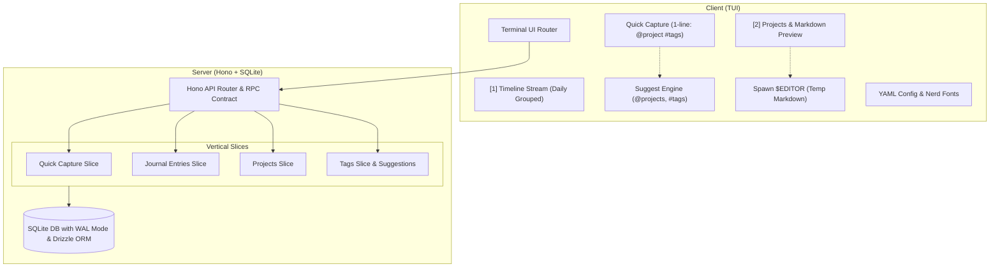

# Journal System Architecture Document

## 1. Overview & System Design

A monorepo-based Journal system structured around a **Client-Server** architecture:
- **Server:** Bun / TypeScript backend using SQLite (`bun:sqlite` + `drizzle-orm/bun-sqlite`), Hono lightweight HTTP router (`Bun.serve`), schema validation with `zod` (`z`), and YAML configuration support. Designed following **Vertical Slice Architecture** (feature-oriented slices: `quick-capture`, `entries`, `projects`, `tags`).
- **Client:** Terminal User Interface (TUI) with a daily grouped continuous stream and project preview pane built on **OpenTUI React**, communicating with the server over local HTTP using Hono's zero-codegen type-safe RPC client (`hono/client`).
- **External Editor:** Editing project markdown content or extensive notes spawns `$EDITOR` (fallback to `$VISUAL` or `nano`/`nvim`) using temporary files, restoring the TUI immediately on save/exit.
- **Auto-Suggestions:** Real-time inline/dropdown suggestions when typing `@` (projects) and `#` (tags) during quick capture, project editing (`p`), and tag editing (`t`).
- **Tooling & Package Management:** Bun workspace monorepo, Biome for ultra-fast linting and formatting, `simple-git-hooks` for pre-commit formatting, and TypeScript strict mode throughout.



---

## 2. Core Domain & Data Model (Drizzle ORM + Zod)

### SQLite Schema (`better-sqlite3` + `drizzle-orm`)
```typescript
import { sqliteTable, text, integer, primaryKey } from "drizzle-orm/sqlite-core";

// Projects Table
export const projects = sqliteTable("projects", {
  id: text("id").primaryKey(),
  name: text("name").notNull().unique(),
  content: text("content").notNull().default(""),
  createdAt: integer("created_at").notNull(),
  updatedAt: integer("updated_at").notNull(),
});

// Journal Entries Table
export const entries = sqliteTable("entries", {
  id: text("id").primaryKey(),
  projectId: text("project_id").notNull().references(() => projects.id, { onDelete: "cascade" }),
  content: text("content").notNull(),
  createdAt: integer("created_at").notNull(),
  updatedAt: integer("updated_at").notNull(),
});

// Tags Table
export const tags = sqliteTable("tags", {
  name: text("name").primaryKey(),
});

// Many-to-Many Join Table
export const entryTags = sqliteTable(
  "entry_tags",
  {
    entryId: text("entry_id").notNull().references(() => entries.id, { onDelete: "cascade" }),
    tagName: text("tag_name").notNull().references(() => tags.name, { onDelete: "cascade", onUpdate: "cascade" }),
  },
  (table) => [
    primaryKey({ columns: [table.entryId, table.tagName] }),
  ]
);
```

---

## 3. Configuration Specification (`journal.config.yaml`)

Loaded from `~/.config/journals/config.yaml` or `./journal.config.yaml` and validated via Zod:

```yaml
appearance:
  use_nerd_font: true
  theme: "nord"

icons:
  nerd:
    journal: ""
    project: ""
    tag: ""
    calendar: ""
    quick: ""
    checked: ""
    unchecked: ""
    bullet: ""
  plain:
    journal: "◆"
    project: "◫"
    tag: "#"
    calendar: "📅"
    quick: "⚡"
    checked: "[x]"
    unchecked: "[ ]"
    bullet: "•"

keymaps:
  view_timeline: "1"
  view_projects: "2"
  up: "k"
  down: "j"
  quick_capture: "n"
  edit_project: "p"
  edit_tags: "t"
  edit_project_content: "e"
  cancel: "escape"
  quit: "q"

quick_add:
  default_project: "Inbox"

server:
  host: "127.0.0.1"
  port: 4321
  db_path: "~/.local/share/journals/data.sqlite"
  wal_mode: true
  auto_start: true
```

---

## 4. Monorepo Structure (Bun workspaces)

```
journals/
├── packages/
│   ├── core/                     # Shared Zod schemas, config parser, domain models
│   │   ├── package.json
│   │   ├── tsconfig.json
│   │   └── src/
│   │       ├── config.ts
│   │       ├── schemas.ts
│   │       └── index.ts
│   │
│   ├── server/                   # Hono HTTP server + Drizzle ORM SQLite (bun:sqlite)
│   │   ├── package.json
│   │   ├── tsconfig.json
│   │   └── src/
│   │       ├── db/
│   │       │   ├── schema.ts
│   │       │   └── client.ts
│   │       ├── slices/           # Vertical Slices
│   │       │   ├── quick-capture/
│   │       │   ├── entries/
│   │       │   ├── projects/
│   │       │   └── tags/
│   │       ├── app.ts            # Hono app and RPC type export
│   │       └── index.ts
│   │
│   └── client-tui/               # Terminal User Interface (OpenTUI React)
│       ├── package.json
│       ├── tsconfig.json
│       └── src/
│           ├── api/              # Hono typed RPC client
│           ├── components/       # Header, StatusBar, Modal
│           ├── hooks/            # useJournalData, useSuggestions
│           ├── views/            # Timeline Stream, Projects Preview, Modals
│           │   ├── timeline/
│           │   ├── projects/
│           │   ├── modals/
│           │   └── App.tsx
│           ├── editor.ts         # $EDITOR spawner for markdown editing
│           ├── suggest.ts        # Tag & project completion engine
│           ├── theme.ts          # Color theme palettes (Rosé Pine Dawn, Nord, etc.)
│           └── index.tsx         # OpenTUI React entrypoint
│
├── configs/
│   └── journal.config.example.yaml
├── biome.json
├── package.json
├── bun.lock
├── tsconfig.base.json
├── CONVENTIONS.md
└── ARCHITECTURE.md
```
